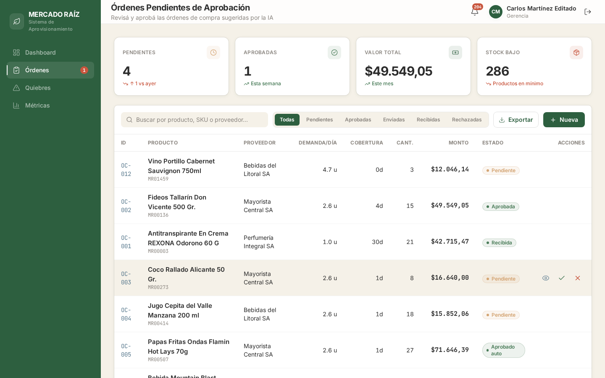

# mercado-raiz

prompt front - back Qwen 3.7
> App generada automáticamente por [MetaBuilder Orchestrator](https://github.com/damianra/metabuilder-orchestrator) usando Devin (via ACP).

**MERCADO RAÍZ** — *"Del campo a tu mesa, con inteligencia"*. Panel de control de órdenes de compra para un retailer de alimentos: detecta stock bajo, genera órdenes de compra y somete a aprobación humana las que superan **$100**. Incluye además un agente autónomo de reposición (`harness-langgraph/`) que ejecuta el ciclo completo con un LLM local.

## Captura



## Stack

- React + Vite + Tailwind CSS (frontend)
- Node.js + Express + PostgreSQL (backend, arquitectura MVC — base `mercadoraiz-db`)
- Vitest (tests) + Playwright + Chromium (E2E)
- LangGraph + Ollama (agente de reposición, `harness-langgraph/`)

## Requisitos

- Node.js >= 20
- Docker o Podman (el Postgres local corre en contenedor)
- (Opcional, para el agente) Ollama con `qwen3:8b`

## Levantar el proyecto

```bash
npm install
cp .env.example .env      # completar JWT_SECRET (ver archivo)
docker compose up -d      # Postgres 16 → base mercadoraiz-db en :5432 (con podman: podman compose up -d)
npm run seed              # puebla la DB: catálogo real de 1.471 artículos + demo del flujo
npm run dev               # frontend en http://localhost:5173
npm run api               # API Express en http://localhost:4000
```

El proxy de Vite redirige `/api` al puerto 4000 en dev.

> **PostgreSQL (SPEC-25)**: la persistencia vive en el contenedor
> `mercadoraiz-db` del `docker-compose.yml` (volumen
> `mercadoraiz-pgdata`). Conexión por `DATABASE_URL` — el default de
> `.env` apunta al compose local. La suite corre contra la base
> hermana `mercadoraiz-db-test` (creada por
> `scripts/init-test-db.sql` en el primer boot) con un schema
> aislado por archivo de test. Para migrar datos de una
> `app.sqlite` anterior: `node server/migrate-sqlite-to-pg.js`
> (corte único — destino debe estar vacío; preserva ids y
> password_hash, no migra refresh_tokens: re-login requerido).
> Reporta counts por tabla + muestras al terminar. Requiere
> Node >= 22.13 (`node:sqlite` nativo).

### Agente de reposición (opcional)

```bash
npm --prefix harness-langgraph install   # deps del agente (también requeridas por `npm test`: la suite incluye harness-langgraph/tests/)
npm run agente   # harness-langgraph (requiere la API en :4000 y Ollama en :11434)
```

El agente lee productos con stock bajo, estima demanda con el LLM, crea órdenes vía HTTP y termina — la corrida es atómica (SPEC-12). Las órdenes que superan el umbral quedan `PENDIENTE_APROBACION` y se aprueban/rechazan desde el dashboard por REST puro del backend. Ver `harness-langgraph/README.md`.

## Scripts

| Comando | Descripción |
|---|---|
| `npm run dev` | Frontend Vite en :5173 |
| `npm run api` | API Express en :4000 |
| `npm run dev:api` | API con `--watch` |
| `npm run seed` | Puebla la DB (TRUNCATE + repuebla — reseteo completo) |
| `npm run build` | Build de producción a `dist/` |
| `npm test` / `npx vitest run` | Suite Vitest (unit + integración) |
| `npm run test:e2e` | E2E Playwright (Chromium) |
| `npm run agente` | Agente LangGraph de reposición |

## API

Base `/api` (auto-mount de `server/routes/<name>.js`). Endpoints principales:

- `GET /api/ordenes` — lista paginada (filtros: `estado`, `requiere_aprobacion`, `fecha_desde/hasta`, `search`, `sort`)
- `GET /api/ordenes/:orden_id` — detalle con `producto{}` y `proveedor{}` anidados
- `POST /api/ordenes` — crea orden (`monto_total` calculado server-side; `>= $50.000` → `PENDIENTE_APROBACION`)
- `POST /api/ordenes/batch` — array de órdenes en una transacción (todo o nada; 400 con detalle por índice si algún item falla — SPEC-16)
- `POST /api/ordenes/:orden_id/aprobar` · `POST /api/ordenes/:orden_id/rechazar` (requiere `motivo`)
- `POST /api/ordenes/:orden_id/enviar` — APROBADA→ENVIADA (la OC ya se le mandó al proveedor; rol aprobador)
- `POST /api/ordenes/:orden_id/recibir` — ENVIADA→RECIBIDA (llegó el camión: suma `stock_actual` + `historial_stock` en tx; `cantidad_recibida` opcional ≤ pedida, default completa — recepciones parciales medibles)
- `GET /api/productos` — lista paginada, `estado` recalculado al leer
- `GET /api/dashboard/stats` — KPIs del dashboard
- `GET /api/historial` — movimientos de stock
- `GET /api/ventas` — hechos de venta (SPEC-26; filtros: `producto_id`, `desde`/`hasta` `YYYY-MM-DD`, `canal` POS/WEB/MAYOR, paginado estándar)
- `POST /api/ventas` — punto de integración POS (SPEC-30 T30.2): descuenta `stock_actual` + `historial_stock` VENTA en la misma tx; el stock puede quedar negativo (la venta es hecho físico — la divergencia se corrige con conteo). Sin rol extra, cualquier no-BUYER
- `POST /api/stock/ajuste` — ajuste manual de inventario (SPEC-30 T30.2): `{producto_id, motivo: MERMA|ROTURA|CONTEO|OTRO, cantidad_nueva?|delta?, referencia?}` — exactamente un modo; conteo de góndola/depósito vive acá. Roles: `GERENTE` y `ADMIN`
- `GET /api/alertas?leida=&tipo=` · `PATCH /api/alertas/:id/leida` · `PATCH /api/alertas/leer-todas` · `POST /api/alertas/evaluar` — alertas operativas (SPEC-29): QUIEBRE/RIESGO_LEAD/DEAD_STOCK/ORDEN_PENDIENTE por reglas determinísticas; evaluación lazy cada 60min en el GET. Roles: `BUYER` y `ADMIN`
- `GET /api/pedidos/sugerencia?producto_id=` · `POST /api/pedidos` — pedido del BUYER desde `/alertas` (SPEC-29 T29.3 + SPEC-30 T30.4): la sugerencia devuelve precios por proveedor + cantidad calculada con la math del agente por lead; el POST crea la OC real `PENDIENTE_APROBACION` (201) y marca la alerta atendida en la misma transacción — idempotente por `alerta_id` (la OC lleva `alerta_id` para trazabilidad, única). Roles: `BUYER` y `ADMIN`
- `GET /api/estadisticas/metricas?dias=` — scorecard agregado (SPEC-28): quiebres en $/día de margen, riesgo por cobertura vs lead, inventario a costo/venta, dead stock, exceso, fill rate, órdenes pendientes y scorecard de proveedores
- `GET /api/estadisticas/demanda?producto_id=&dias=` — estadísticas de demanda por producto (R26.7: demanda ponderada, tendencia, CV, σ, días con venta/en quiebre, última venta); sin `producto_id` devuelve `{data:[...]}` con las mismas stats de todos los productos (R26.9 — las columnas demanda/cobertura del dashboard)
- `GET|POST /api/usuarios` · `PATCH|DELETE /api/usuarios/:id` — CRUD de usuarios, solo rol `ADMIN` (SPEC-24; soft delete, revoca sesiones del afectado)
- `GET|POST /api/proveedores` · `GET|PATCH|DELETE /api/proveedores/:id` — CRUD de proveedores, solo rol `ADMIN` (SPEC-26; soft delete `activo=0`, 409 si hay órdenes `PENDIENTE_APROBACION`/`ENVIADA` vivas)

Contrato completo en `SPEC.md` → SPEC-03.

## Datos externos

`data/articles_sample.csv` — muestra de 1.471 artículos canónicos
presentes y activos en las 4 cadenas scrapeadas por retail-radar
(Día, Coto, Carrefour, La Anónima), con SKU y precio por cadena.
Base para las comparaciones del mercado propio. Diccionario de
columnas en `data/README.md`; se regenera con
`data/export_sample.sql`. (SPEC-21)

Es además el origen del **catálogo interno**: `server/seed-articulos.js`
convierte cada artículo canónico en un producto propio — sku `MR#####`,
marca, EAN, categoría, precio propio (determinístico, ~21% por encima
del máximo de mercado para análisis de competitividad) y stock con mix
CRITICO/STOCK_BAJO/OK. `productos` gana columnas `marca`/`ean`: bases
existentes deben re-seedear (`npm run seed` trunca y repuebla).
(SPEC-22)

## Specs

La especificación completa (SDD) está en [`SPEC.md`](SPEC.md). Cada SPEC declara origen → requisitos → contrato → implementación → tests:

| SPEC | Alcance |
|---|---|
| SPEC-01 | Sistema de diseño y shell UI (paleta, tipografía, sidebar/topbar) |
| SPEC-02 | Modelo de datos (schema idempotente, seed, WAL) |
| SPEC-03 | API REST del dominio (contrato de endpoints, errores) |
| SPEC-04 | Integración front ↔ back (`api.js`, mapeo de estados, reglas de UI) |
| SPEC-05 | Reglas de negocio (umbral $50.000 — recalibrado en SPEC-22, `OC-NNN`, fórmula de cantidad) |
| SPEC-06 | Seguridad y compliance (headers, rate limit, ~~uploads~~ — retirado en SPEC-20, `/privacidad`) |
| SPEC-07 | Testing (suites y cobertura) |
| SPEC-08 | Agente LangGraph (grafo, checkpoints, human-in-the-loop) |
| SPEC-09 | DevEx y operación (scripts, Docker, CI, `.env`) |
| … | SPEC-10→20 en `SPEC.md` (observabilidad, stress, performance del agente, higiene) |
| SPEC-21 | Dataset externo: muestra de artículos retail-radar (`data/`) |
| SPEC-22 | Catálogo interno de artículos (seed real desde el dataset, sku `MR#####`, marca/EAN) |
| SPEC-23 | Autenticación JWT (login + refresh rotativo + roles + cuenta de servicio del agente) |
| SPEC-24 | Gestión de usuarios y roles (CRUD `/api/usuarios` + pantalla admin `/usuarios`) |
| SPEC-25 | Migración de persistencia a PostgreSQL (`mercadoraiz-db` en Docker) |
| SPEC-26 | Demanda real y proveedores enriquecidos (`ventas`, `/api/estadisticas/demanda`, CRUD `/proveedores`) |
| SPEC-27 | Precios por proveedor y margen (`producto_proveedor`, `precio_venta`/`costo`, agente elige proveedor, vista `/quiebres`) |
| SPEC-28 | Scorecard de métricas retail (`/api/estadisticas/metricas` + vista `/metricas`) |
| SPEC-29 | Alertas operativas + rol BUYER (`/api/alertas`, reglas determinísticas, dashboard exclusivo `/alertas`) |

## Usuarios demo

La app exige login (SPEC-23): JWT de 15 min en memoria + refresh
rotativo en cookie httpOnly. Usuarios del seed (`npm run seed`):

| Email | Password dev | Rol | Puede |
|---|---|---|---|
| carlos.martinez@mercadorai.com | `demo-gerente-2026` | GERENTE | leer, crear, aprobar/rechazar, enviar/recibir OCs |
| maria.lopez@mercadorai.com | `demo-aprobadora-2026` | APROBADOR | leer, crear, aprobar/rechazar, enviar/recibir OCs |
| admin@mercadorai.com | `demo-admin-2026` | ADMIN | todo + gestión de usuarios |
| agente@mercadorai.com | `demo-agente-2026` | SERVICIO | leer + crear órdenes (cuenta del agente LangGraph — no puede aprobar) |
| buyer@mercadorai.com | `demo-buyer-2026` | BUYER | solo `/alertas` — el resto del dominio devuelve 403 (SPEC-29) |

Las passwords dev también sirven para el agente
(`harness-langgraph/.env` → `AGENTE_EMAIL`/`AGENTE_PASSWORD`).

Con rol `ADMIN` aparece el ítem **Usuarios** en el sidebar →
`/usuarios`: alta, edición, cambio de rol y activar/desactivar
(soft delete — el registro queda para la auditoría y sus sesiones
se revocan). Un admin no puede desactivarse ni degradarse a sí
mismo, y el backend impide dejar el sistema sin el último ADMIN
activo (`409`).

Todos los roles ven **Quiebres** en el sidebar → `/quiebres`
(SPEC-27 T27.4): la lista de acción diaria — productos en cero o
bajo el mínimo ordenados por margen que se deja de ganar por día
(`demanda × margen_unitario`), con KPIs de SKUs sin stock, margen
en riesgo/día y margen perdido en 90 días. Solo `ADMIN` ve
además **Proveedores** (`/proveedores`, SPEC-26). También todos
los roles ven **Métricas** (`/metricas`, SPEC-28): fill rate,
margen en riesgo/día, inventario a costo, dead stock, exceso,
órdenes por aprobar y scorecard de proveedores (SKUs, lead
esperado, confiabilidad, órdenes y montos).

Endpoints de auth: `POST /api/auth/login` → `{access_token, usuario}`
+ cookies `mr_refresh` (httpOnly) y `mr_csrf` (legible → header
`X-CSRF-Token` en refresh/logout); `POST /refresh` rota el par;
`POST /logout` revoca; `GET /me`; `POST /cambiar-password` invalida
todas las sesiones (`token_version++`). Todas las rutas del dominio
exigen `Authorization: Bearer` — el `aprobado_por` sale del JWT.
5 fallos de login bloquean la cuenta 15 min; límites configurables
vía `AUTH_RATE_LIMIT` (login) y `API_RATE_LIMIT` (escrituras).

## Tests

```bash
npx vitest run      # tests unitarios e integración
npm run test:e2e    # E2E Playwright (Chromium) — levanta seed + api + dev solo
```

## Deploy

Si el proyecto se generó con `--github`, el build de `dist/` queda publicado en GitHub Pages (`https://<usuario>.github.io/mercado-raiz/`). Pages sirve solo el frontend; en apps fullstack el backend corre aparte (`npm run api`).

El `Dockerfile` multi-stage construye `dist/` y corre `node server/index.js`, que sirve API + estáticos en un solo contenedor.

## Prompt

El brief original que generó el proyecto está commiteado en [`plan.json`](plan.json) → campo `idea` (~29KB, incluye la sección BACKEND completa: schema, endpoints, lógica de negocio y mocks). `plan.json.steps` contiene las 6 instrucciones de ejecución; la trazabilidad plan → spec → código → tests está en `SPEC.md` → Anexo A.
