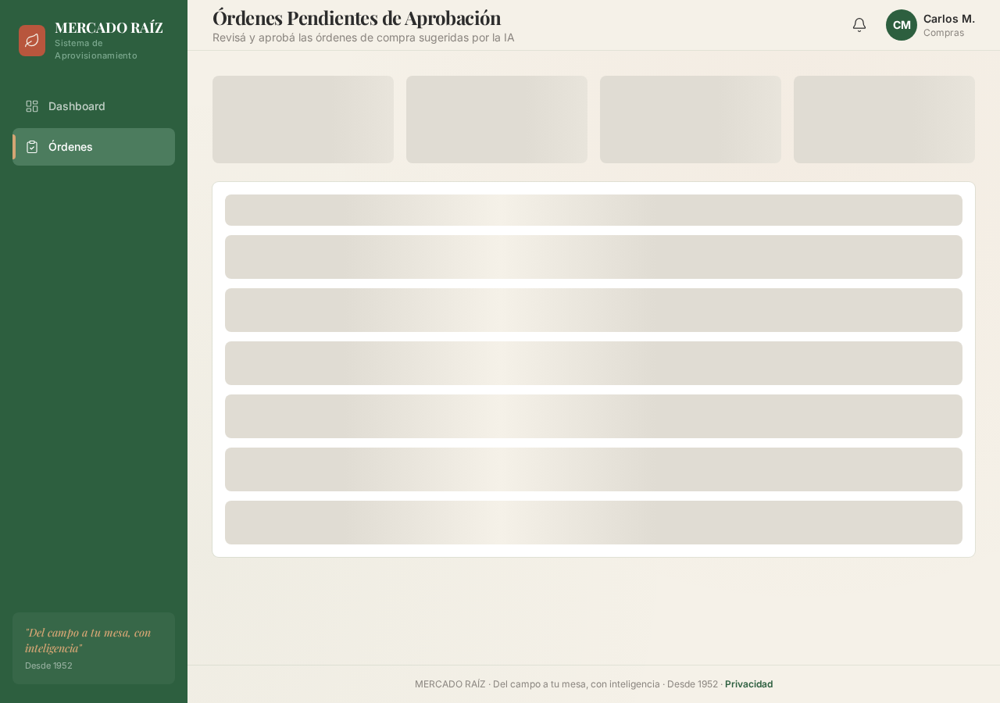

# mercado-raiz

**Nombre:** MERCADO RAÍZ   **Tagline:** "Del campo a tu mesa, con inteligencia"   **Personalidad:** Premium pero accesible, orgánico pero tecnológico, confiable pero moderno   **Año de fundación ficticio:** 1952 (evoca tradición + innovación)  ---  ## 🎨 Sistema de Diseño  ### Paleta de Colores  **Primarios:** - Verde Raíz: `#2D5F3F` (confianza, naturaleza) - Terracota: `#C8553D` (calidez, urgencia suave) - Crema: `#F5F1E8` (fondo principal, no blanco puro)  **Secundarios:** - Verde Claro: `#7BA88E` (acentos, estados positivos) - Ocre: `#D4A574` (destacados, badges) - Grafito: `#2C2C2C` (texto principal) - Gris Cálido: `#8B8680` (texto secundario)  **Estados:** - Éxito: `#4A7C59` - Advertencia: `#D4A574` - Error: `#C8553D` - Info: `#5B7B8F`  ### Tipografía  **Títulos:** "Playfair Display" (serif elegante, transmite tradición premium)   **UI/Body:** "Inter" (sans-serif moderna, legibilidad perfecta)   **Monospace:** "JetBrains Mono" (para SKUs, números, datos técnicos)  ### Estilo Visual  - **Bordes:** 8px de border-radius (suave, no rectangular, no circular) - **Sombras:** Sutiles, difusas (`box-shadow: 0 2px 8px rgba(45, 95, 63, 0.08)`) - **Espaciado:** Generoso, respirable (padding 24px, gaps 16px) - **Iconografía:** Line icons de 1.5px stroke, estilo "Feather Icons" - **Animaciones:** Transiciones suaves de 200ms, easing `cubic-bezier(0.4, 0, 0.2, 1)`  ---  ## 🖥️ Estructura del Dashboard  ### Layout Principal  ``` ┌─────────────────────────────────────────────────────────────┐ │  SIDEBAR (240px)  │  MAIN CONTENT (fluid)                   │ │  ┌──────────────┐ │  ┌─────────────────────────────────┐   │ │  │ LOGO         │ │  │ HEADER                          │   │ │  │ MERCADO RAÍZ │ │  │ "Órdenes Pendientes" + Usuario  │   │ │  └──────────────┘ │  └─────────────────────────────────┘   │ │                   │  ┌─────────────────────────────────┐   │ │  ┌──────────────┐ │  │ STATS CARDS (4 columnas)        │   │ │  │ 📊 Dashboard │ │  │ Pendientes | Aprobadas | $$    │   │ │  │ ✓ Órdenes    │ │  └─────────────────────────────────┘   │ │  │ 📦 Inventario│ │  ┌─────────────────────────────────┐   │ │  │ 👥 Proveed.  │ │  │ TABLA DE ÓRDENES                │   │ │  │ ⚙️ Config    │ │  │ [Filtros] [Buscar]              │   │ │  └──────────────┘ │  │                                 │   │ │                   │  │ ┌─────────────────────────────┐ │   │ │  ┌──────────────┐ │  │ │ OC-001 | Leche | $36 | ✓  │ │   │ │  │ URGENTE: 2   │ │  │ └─────────────────────────────┘ │   │ │  │ badges rojos │ │  │ ┌─────────────────────────────┐ │   │ │  └──────────────┘ │  │ │ OC-002 | Huevos| $140| ⏳  │ │   │ │                   │  │ └─────────────────────────────┘ │   │ │                   │  └─────────────────────────────────┘   │ └─────────────────────────────────────────────────────────────┘ ```  ---  ## 🎯 Componentes Detallados  ### 1. Sidebar (Navegación Lateral)  **Especificaciones CSS:** ```css width: 240px background: #2D5F3F (verde raíz) padding: 24px 16px  /* Logo */ - Icono: Hoja estilizada en terracota - Texto: "MERCADO RAÍZ" en Playfair Display, 20px, blanco - Subtexto: "Sistema de Aprovisionamiento" en Inter, 12px, verde claro  /* Menú */ - Items: 48px height, padding 12px 16px - Icono + Texto (16px Inter) - Hover: background rgba(255,255,255,0.1) - Active: background #7BA888, border-left 4px solid #D4A574  /* Badge de Urgencia */ - Position: absolute, top-right del item - Background: #C8553D - Texto: número blanco, bold - Border-radius: 12px - Padding: 2px 8px ```  ### 2. Header Superior  ``` ┌─────────────────────────────────────────────────────────┐ │  Órdenes Pendientes de Aprobación    🔔 3  👤 Carlos M. │ │  Subtítulo: "Revisa y aprueba las órdenes de compra"   │ └─────────────────────────────────────────────────────────┘  - Background: #F5F1E8 (crema) - Border-bottom: 1px solid rgba(45, 95, 63, 0.1) - Título: Playfair Display, 28px, #2C2C2C - Subtítulo: Inter, 14px, #8B8680 - Icono notificación: con badge rojo si hay urgentes - Avatar usuario: círculo 40px, iniciales "CM" en verde ```  ### 3. Tarjetas de Estadísticas (KPIs)  ``` ┌──────────────┬──────────────┬──────────────┬──────────────┐ │ ⏳ 2         │ ✓ 15         │ 💰 $2,450    │ 📦 127       │ │ Pendientes   │ Aprobadas    │ Valor Total  │ Productos    │ │ ↑ 1 vs ayer  │ Esta semana  │ Este mes     │ En stock bajo│ └──────────────┴──────────────┴──────────────┴──────────────┘  /* Especificaciones */ - Grid: 4 columnas, gap 16px - Card: background blanco, border-radius 8px - Padding: 24px - Shadow: 0 2px 8px rgba(45, 95, 63, 0.08) - Número grande: 36px, Playfair Display, bold, #2D5F3F - Label: 14px, Inter, #8B8680 - Trend: 12px, verde si ↑, terracota si ↓ - Icono: 24px, color del acento de la tarjeta ```  ### 4. Tabla de Órdenes (Componente Principal)  ``` ┌─────────────────────────────────────────────────────────────┐ │ 🔍 Buscar...          [Filtros ▾]  [Exportar]  [+ Nueva]   │ ├─────────────────────────────────────────────────────────────┤ │ ID      │ Producto        │ Cant. │ Monto  │ Estado │ Acc. │ ├─────────────────────────────────────────────────────────────┤ │ OC-001  │ Leche Entera 1L │ 30    │ $36.00 │ ✓ Auto │ 👁️  │ │ OC-002  │ Huevos x12      │ 40    │ $140.00│ ⏳ Pend│ ✓ ✗  │ │ OC-003  │ Pan Integral    │ 25    │ $45.00 │ ⏳ Pend│ ✓ ✗  │ └─────────────────────────────────────────────────────────────┘  /* Fila de Orden */ - Height: 64px - Hover: background #F5F1E8 - Border-bottom: 1px solid rgba(45, 95, 63, 0.05)  /* Columnas */ - ID: JetBrains Mono, 14px, #5B7B8F - Producto: Inter, 15px, #2C2C2C, bold - Cantidad: Inter, 14px, #2C2C2C - Monto: JetBrains Mono, 15px, #2D5F3F, bold - Estado: Badge con color según estado - Acciones: Iconos 20px, hover cambia color  /* Badges de Estado */ - Aprobado Auto: background #E8F5E9, texto #4A7C59 - Pendiente: background #FFF4E6, texto #D4A574 - Rechazado: background #FFEBEE, texto #C8553D - Border-radius: 16px - Padding: 4px 12px - Font-size: 12px, bold ```  ### 5. Modal de Detalle de Orden (Al hacer clic en 👁️)  ``` ┌─────────────────────────────────────────────────────────────┐ │  ✕                                              OC-002     │ ├─────────────────────────────────────────────────────────────┤ │                                                             │ │  📦 Huevos x12                                              │ │  SKU: HUE003 | Proveedor: Granja El Sol                    │ │                                                             │ │  ┌─────────────┬─────────────┬─────────────┐               │ │  │ Stock Actual│ Mínimo      │ A Ordenar   │               │ │  │ 8 unidades  │ 25 unidades │ 40 unidades │               │ │  └─────────────┴─────────────┴─────────────┘               │ │                                                             │ │  💰 Cálculo Financiero                                      │ │  ┌─────────────────────────────────────────────────────┐   │ │  │ Precio unitario: $3.50                              │   │ │  │ Cantidad: 40                                        │   │ │  │ ─────────────────────────────────                   │   │ │  │ TOTAL: $140.00                                      │   │ │  └─────────────────────────────────────────────────────┘   │ │                                                             │ │  🤖 Análisis de IA                                          │ │  ┌─────────────────────────────────────────────────────┐   │ │  │ "Basado en ventas de las últimas 2 semanas, se     │   │ │  │  recomienda ordenar 40 unidades. Ventas promedio:  │   │ │  │  5 unidades/día. Tiempo de entrega proveedor: 2    │   │ │  │  días. Stock se agotará en ~1.6 días."             │   │ │  └─────────────────────────────────────────────────────┘   │ │                                                             │ │  ┌─────────────────────────────────────────────────────┐   │ │  │  [ ✗ Rechazar ]          [ ✓ Aprobar Orden ]        │   │ │  └─────────────────────────────────────────────────────┘   │ │                                                             │ └─────────────────────────────────────────────────────────────┘  /* Especificaciones del Modal */ - Overlay: rgba(44, 44, 44, 0.5) con backdrop-filter blur(4px) - Modal: 640px width, max-height 90vh, overflow-y auto - Background: #F5F1E8 - Border-radius: 12px - Padding: 32px  /* Secciones */ - Título producto: Playfair Display, 24px, #2C2C2C - SKU/Proveedor: Inter, 14px, #8B8680 - Cards de métricas: background blanco, padding 16px, border-radius 8px - Análisis IA: background #E8F5E9, border-left 4px solid #4A7C59, padding 16px  /* Botones */ - Aprobar: background #2D5F3F, texto blanco, 48px height, border-radius 8px - Rechazar: background transparente, border 2px solid #C8553D, texto #C8553D - Hover: transform translateY(-2px), shadow aumenta ```  ---  ## 🎬 Interacciones y Micro-animaciones  ### Al Aprobar una Orden  ``` 1. Botón cambia a "Aprobando..." con spinner 2. Fila de la tabla hace fade-out (200ms) 3. Badge de estadísticas "Pendientes" decrementa con animación 4. Toast notification aparece: "✓ Orden OC-002 aprobada" 5. Toast desaparece después de 3 segundos ```  ### Al Cargar Datos  ``` - Skeleton loaders en lugar de spinners - Forma de las cards/tablas pero con shimmer effect - Color: #E0DCD3 → #F5F1E8 → #E0DCD3 (animación infinita) ```  ### Hover en Filas de Tabla  ``` - Background cambia a #F5F1E8 (150ms) - Botones de acción aparecen con fade-in - Cursor cambia a pointer ```  ---  ## 📱 Responsive Design  ### Desktop (>1200px) - Sidebar fijo, 240px - Tabla con todas las columnas visibles  ### Tablet (768px - 1200px) - Sidebar colapsable (iconos solamente, 64px) - Tabla con scroll horizontal  ### Mobile (<768px) - Sidebar como drawer (hamburger menu) - Tabla se convierte en cards apiladas - Cada orden es una card con toda la info  ---  ## 🎯 Datos de Ejemplo Realistas  ```javascript const ordenesEjemplo = [   {     id: "OC-001",     producto: "Leche Entera 1L",     sku: "LEC001",     cantidad: 30,     monto: 36.00,     proveedor: "Lácteos SA",     estado: "APROBADO_AUTO",     fecha: "2026-10-31T08:23:00",     analisisIA: "Stock crítico. Reposición urgente recomendada."   },   {     id: "OC-002",     producto: "Huevos x12",     sku: "HUE003",     cantidad: 40,     monto: 140.00,     proveedor: "Granja El Sol",     estado: "PENDIENTE_APROBACION",     fecha: "2026-10-31T08:23:00",     analisisIA: "Alta demanda esperada por fin de semana. Ordenar 40 unidades."   },   {     id: "OC-003",     producto: "Pan Integral",     sku: "PAN002",     cantidad: 25,     monto: 45.00,     proveedor: "Panadería Central",     estado: "PENDIENTE_APROBACION",     fecha: "2026-10-31T08:23:00",     analisisIA: "Producto de alta rotación. Tiempo de entrega: 1 día."   } ]; ```  ---  ## 🎨 Elementos de Marca Únicos  ### Icono de Hoja (Logo)  ```svg <!-- Hoja estilizada con vetas visibles, transmite naturaleza + tecnología --> <svg viewBox="0 0 40 40">   <path d="M20 5 C10 10, 5 20, 10 30 C15 35, 25 35, 30 30 C35 20, 30 10, 20 5 Z"          fill="#C8553D"/>   <path d="M20 8 L20 32 M15 15 L20 20 M25 15 L20 20"          stroke="#F5F1E8" stroke-width="1.5" fill="none"/> </svg> ```  ### Patrón de Fondo Sutil  ```css /* Textura orgánica en el fondo principal */ background-image:    radial-gradient(circle at 20% 80%, rgba(45, 95, 63, 0.03) 0%, transparent 50%),   radial-gradient(circle at 80% 20%, rgba(200, 85, 61, 0.03) 0%, transparent 50%); ```  ### Tipografía de Números  ```css /* Todos los números (SKUs, montos, cantidades) en JetBrains Mono */ /* Transmite precisión técnica + confianza en datos */ font-family: 'JetBrains Mono', monospace; font-variant-numeric: tabular-nums; /* Alineación perfecta en tablas */ ```  ---  ## ✅ Checklist de Implementación  - [ ] Sidebar con navegación y badge de urgentes - [ ] Header con título dinámico y avatar usuario - [ ] 4 tarjetas de KPIs con animaciones - [ ] Tabla de órdenes con filtros y búsqueda - [ ] Modal de detalle con análisis de IA - [ ] Botones de aprobar/rechazar con feedback visual - [ ] Toast notifications - [ ] Skeleton loaders - [ ] Responsive (desktop, tablet, mobile) - [ ] Accesibilidad (ARIA labels, contraste WCAG AA) - [ ] Animaciones sutiles (no distractoras)  ---  ## 🚀 Tecnologías Recomendadas para el Front  ```json {   "framework": "React + Vite",   "styling": "Tailwind CSS + CSS Modules",   "componentes": "Shadcn/ui (customizados con la paleta)",   "iconos": "Lucide React",   "tablas": "TanStack Table",   "animaciones": "Framer Motion",   "estado": "Zustand o React Query",   "gráficos": "Recharts (si agregan dashboard analytics)" } ```  ---

BACKEND
## 🗄️ Base de Datos - Schema Completo

### Tabla: `productos`

```sql
CREATE TABLE productos (
  id INTEGER PRIMARY KEY AUTOINCREMENT,
  sku TEXT UNIQUE NOT NULL,
  nombre TEXT NOT NULL,
  categoria TEXT NOT NULL,
  stock_actual INTEGER NOT NULL DEFAULT 0,
  stock_minimo INTEGER NOT NULL,
  precio_unitario REAL NOT NULL,
  proveedor_id INTEGER NOT NULL,
  ubicacion TEXT,
  estado TEXT DEFAULT 'OK',
  fecha_actualizacion DATETIME DEFAULT CURRENT_TIMESTAMP,
  
  FOREIGN KEY (proveedor_id) REFERENCES proveedores(id)
);

CREATE INDEX idx_productos_sku ON productos(sku);
CREATE INDEX idx_productos_estado ON productos(estado);
CREATE INDEX idx_productos_stock ON productos(stock_actual);
```

**Estados del producto:**
- `OK`: stock_actual >= stock_minimo
- `STOCK_BAJO`: stock_actual < stock_minimo AND stock_actual > 0
- `CRITICO`: stock_actual == 0

### Tabla: `proveedores`

```sql
CREATE TABLE proveedores (
  id INTEGER PRIMARY KEY AUTOINCREMENT,
  nombre TEXT NOT NULL,
  contacto TEXT,
  telefono TEXT,
  email TEXT,
  tiempo_entrega_dias INTEGER NOT NULL,
  activo BOOLEAN DEFAULT 1,
  fecha_creacion DATETIME DEFAULT CURRENT_TIMESTAMP
);
```

### Tabla: `ordenes_compra`

```sql
CREATE TABLE ordenes_compra (
  id INTEGER PRIMARY KEY AUTOINCREMENT,
  orden_id TEXT UNIQUE NOT NULL,
  producto_id INTEGER NOT NULL,
  proveedor_id INTEGER NOT NULL,
  cantidad INTEGER NOT NULL,
  precio_unitario REAL NOT NULL,
  monto_total REAL NOT NULL,
  estado TEXT NOT NULL DEFAULT 'PENDIENTE_APROBACION',
  requiere_aprobacion BOOLEAN NOT NULL DEFAULT 0,
  analisis_ia TEXT,
  aprobado_por TEXT,
  fecha_aprobacion DATETIME,
  fecha_creacion DATETIME DEFAULT CURRENT_TIMESTAMP,
  fecha_actualizacion DATETIME DEFAULT CURRENT_TIMESTAMP,
  
  FOREIGN KEY (producto_id) REFERENCES productos(id),
  FOREIGN KEY (proveedor_id) REFERENCES proveedores(id)
);

CREATE INDEX idx_ordenes_estado ON ordenes_compra(estado);
CREATE INDEX idx_ordenes_fecha ON ordenes_compra(fecha_creacion);
```

**Estados de orden:**
- `PENDIENTE_APROBACION`: Requiere revisión humana
- `APROBADA`: Aprobada por humano o auto-aprobada
- `RECHAZADA`: Rechazada por humano
- `ENVIADA`: Enviada al proveedor
- `RECIBIDA`: Mercadería recibida

### Tabla: `historial_stock`

```sql
CREATE TABLE historial_stock (
  id INTEGER PRIMARY KEY AUTOINCREMENT,
  producto_id INTEGER NOT NULL,
  tipo_movimiento TEXT NOT NULL,
  cantidad_anterior INTEGER NOT NULL,
  cantidad_nueva INTEGER NOT NULL,
  diferencia INTEGER NOT NULL,
  referencia TEXT,
  usuario TEXT,
  fecha DATETIME DEFAULT CURRENT_TIMESTAMP,
  
  FOREIGN KEY (producto_id) REFERENCES productos(id)
);
```

**Tipos de movimiento:**
- `VENTA`: Reducción por venta
- `REPOSICION`: Aumento por orden de compra
- `AJUSTE`: Corrección manual
- `DEVOLUCION`: Aumento por devolución

### Tabla: `usuarios`

```sql
CREATE TABLE usuarios (
  id INTEGER PRIMARY KEY AUTOINCREMENT,
  email TEXT UNIQUE NOT NULL,
  nombre TEXT NOT NULL,
  rol TEXT NOT NULL,
  avatar_url TEXT,
  activo BOOLEAN DEFAULT 1,
  fecha_creacion DATETIME DEFAULT CURRENT_TIMESTAMP
);
```

**Roles:**
- `APROBADOR`: Puede aprobar/rechazar órdenes
- `GERENTE`: Puede aprobar + ver reportes
- `ADMIN`: Acceso completo

---

## 🔌 Endpoints REST API

### Base URL: `/api/v1`

### 1. **GET /ordenes** - Listar órdenes de compra

**Query Params:**
```typescript
{
  estado?: 'PENDIENTE_APROBACION' | 'APROBADA' | 'RECHAZADA' | 'ENVIADA' | 'RECIBIDA',
  requiere_aprobacion?: boolean,
  fecha_desde?: string,
  fecha_hasta?: string,
  page?: number,
  limit?: number,
  sort?: 'fecha_creacion' | 'monto_total' | 'estado',
  order?: 'ASC' | 'DESC'
}
```

**Response:**
```json
{
  "data": [
    {
      "id": 1,
      "orden_id": "OC-002",
      "producto": {
        "sku": "HUE003",
        "nombre": "Huevos x12",
        "stock_actual": 8,
        "stock_minimo": 25
      },
      "proveedor": {
        "nombre": "Granja El Sol",
        "tiempo_entrega_dias": 2
      },
      "cantidad": 40,
      "precio_unitario": 3.50,
      "monto_total": 140.00,
      "estado": "PENDIENTE_APROBACION",
      "requiere_aprobacion": true,
      "analisis_ia": "Alta demanda esperada por fin de semana. Ordenar 40 unidades.",
      "fecha_creacion": "2026-10-31T08:23:00Z"
    }
  ],
  "pagination": {
    "page": 1,
    "limit": 20,
    "total": 45,
    "totalPages": 3
  }
}
```

---

### 2. **GET /ordenes/:orden_id** - Detalle de una orden

**Response:**
```json
{
  "id": 2,
  "orden_id": "OC-002",
  "producto": {
    "sku": "HUE003",
    "nombre": "Huevos x12",
    "categoria": "Lácteos y Huevos",
    "stock_actual": 8,
    "stock_minimo": 25,
    "precio_unitario": 3.50,
    "ubicacion": "Pasillo 5",
    "estado": "STOCK_BAJO"
  },
  "proveedor": {
    "id": 3,
    "nombre": "Granja El Sol",
    "contacto": "Juan Pérez",
    "telefono": "+54 11 5555-0123",
    "email": "ventas@granjaelsol.com",
    "tiempo_entrega_dias": 2
  },
  "cantidad": 40,
  "precio_unitario": 3.50,
  "monto_total": 140.00,
  "estado": "PENDIENTE_APROBACION",
  "requiere_aprobacion": true,
  "analisis_ia": "Basado en ventas de las últimas 2 semanas, se recomienda ordenar 40 unidades. Ventas promedio: 5 unidades/día. Tiempo de entrega proveedor: 2 días. Stock se agotará en ~1.6 días.",
  "aprobado_por": null,
  "fecha_aprobacion": null,
  "fecha_creacion": "2026-10-31T08:23:00Z",
  "fecha_actualizacion": "2026-10-31T08:23:00Z"
}
```

---

### 3. **POST /ordenes/:orden_id/aprobar** - Aprobar una orden

**Body:**
```json
{
  "aprobado_por": "carlos.martinez@mercadorai.com",
  "comentario": "Aprobado por alta demanda esperada"
}
```

**Response:**
```json
{
  "success": true,
  "message": "Orden OC-002 aprobada exitosamente",
  "data": {
    "orden_id": "OC-002",
    "estado": "APROBADA",
    "aprobado_por": "carlos.martinez@mercadorai.com",
    "fecha_aprobacion": "2026-10-31T10:15:00Z"
  }
}
```

**Lógica:**
1. Validar que la orden existe y está en estado `PENDIENTE_APROBACION`
2. Actualizar estado a `APROBADA`
3. Registrar `aprobado_por` y `fecha_aprobacion`

---

### 4. **POST /ordenes/:orden_id/rechazar** - Rechazar una orden

**Body:**
```json
{
  "rechazado_por": "carlos.martinez@mercadorai.com",
  "motivo": "Stock suficiente para cubrir demanda actual"
}
```

**Response:**
```json
{
  "success": true,
  "message": "Orden OC-002 rechazada",
  "data": {
    "orden_id": "OC-002",
    "estado": "RECHAZADA",
    "motivo": "Stock suficiente para cubrir demanda actual"
  }
}
```

**Lógica:**
1. Validar que la orden está en estado `PENDIENTE_APROBACION`
2. Actualizar estado a `RECHAZADA`
3. Registrar motivo

---

### 5. **GET /productos** - Listar productos

**Query Params:**
```typescript
{
  estado?: 'OK' | 'STOCK_BAJO' | 'CRITICO',
  categoria?: string,
  proveedor_id?: number,
  search?: string,
  page?: number,
  limit?: number
}
```

**Response:**
```json
{
  "data": [
    {
      "id": 1,
      "sku": "LEC001",
      "nombre": "Leche Entera 1L",
      "categoria": "Lácteos",
      "stock_actual": 5,
      "stock_minimo": 20,
      "precio_unitario": 1.20,
      "proveedor": {
        "id": 1,
        "nombre": "Lácteos SA"
      },
      "ubicacion": "Pasillo 3",
      "estado": "STOCK_BAJO",
      "fecha_actualizacion": "2026-10-31T08:00:00Z"
    }
  ],
  "pagination": {
    "page": 1,
    "limit": 20,
    "total": 127,
    "totalPages": 7
  }
}
```

---

### 6. **GET /dashboard/stats** - KPIs del Dashboard

**Response:**
```json
{
  "ordenes_pendientes": 2,
  "ordenes_aprobadas_semana": 15,
  "valor_total_mes": 2450.00,
  "productos_stock_bajo": 127,
  "productos_criticos": 8,
  "tendencia": {
    "ordenes_pendientes_vs_ayer": 1,
    "ordenes_aprobadas_vs_semana_anterior": 3
  }
}
```

**Cálculos SQL:**
```sql
-- órdenes_pendientes
SELECT COUNT(*) FROM ordenes_compra WHERE estado = 'PENDIENTE_APROBACION';

-- órdenes_aprobadas_semana
SELECT COUNT(*) FROM ordenes_compra 
WHERE estado = 'APROBADA' AND fecha_aprobacion >= date('now', '-7 days');

-- valor_total_mes
SELECT COALESCE(SUM(monto_total), 0) FROM ordenes_compra 
WHERE estado = 'APROBADA' AND fecha_aprobacion >= date('now', 'start of month');

-- productos_stock_bajo
SELECT COUNT(*) FROM productos 
WHERE stock_actual < stock_minimo AND stock_actual > 0;

-- productos_criticos
SELECT COUNT(*) FROM productos WHERE stock_actual = 0;
```

---

### 7. **POST /ordenes** - Crear nueva orden

**Body:**
```json
{
  "producto_id": 3,
  "cantidad": 40,
  "requiere_aprobacion": true,
  "analisis_ia": "Alta demanda esperada por fin de semana."
}
```

**Response:**
```json
{
  "success": true,
  "message": "Orden creada exitosamente",
  "data": {
    "id": 3,
    "orden_id": "OC-003",
    "producto_id": 3,
    "proveedor_id": 3,
    "cantidad": 40,
    "precio_unitario": 3.50,
    "monto_total": 140.00,
    "estado": "PENDIENTE_APROBACION",
    "requiere_aprobacion": true,
    "analisis_ia": "Alta demanda esperada por fin de semana.",
    "fecha_creacion": "2026-10-31T08:23:00Z"
  }
}
```

**Lógica:**
1. Obtener producto y proveedor
2. Calcular `monto_total = cantidad * precio_unitario`
3. Determinar `requiere_aprobacion` basado en umbral ($100)
4. Generar `orden_id` secuencial (OC-001, OC-002, etc.)
5. Insertar en BD

---

## 🧮 Lógica de Negocio y Cálculos

### 1. **Detección de Stock Bajo**

```typescript
function calcularEstadoProducto(producto: {
  stock_actual: number;
  stock_minimo: number;
}): 'OK' | 'STOCK_BAJO' | 'CRITICO' {
  if (producto.stock_actual === 0) return 'CRITICO';
  if (producto.stock_actual < producto.stock_minimo) return 'STOCK_BAJO';
  return 'OK';
}
```

### 2. **Cálculo de Cantidad a Ordenar**

**Fórmula Base:**
```
cantidad_a_ordenar = (stock_minimo * 2) - stock_actual
```

**Ejemplo:**
- Stock actual: 8 unidades
- Stock mínimo: 25 unidades
- Cantidad a ordenar: (25 * 2) - 8 = 42 unidades

### 3. **Cálculo de Monto Total**

```typescript
function calcularMontoTotal(cantidad: number, precioUnitario: number): number {
  return Math.round(cantidad * precioUnitario * 100) / 100;
}
```

### 4. **Umbral de Aprobación Humana**

```typescript
const UMBRAL_APROBACION = 100; // $100

function requiereAprobacion(montoTotal: number): boolean {
  return montoTotal >= UMBRAL_APROBACION;
}
```

**Regla:** Si monto_total >= $100, requiere aprobación humana. Si < $100, se aprueba automáticamente.

### 5. **Generación de ID de Orden**

```typescript
async function generarOrdenId(db: Database): Promise<string> {
  const result = db.prepare(`
    SELECT MAX(CAST(SUBSTR(orden_id, 4) AS INTEGER)) as max_id 
    FROM ordenes_compra
  `).get();
  
  const nextId = (result?.max_id || 0) + 1;
  return `OC-${String(nextId).padStart(3, '0')}`;
}
```

---

## 📊 Mapeo de Datos: Frontend ←→ Backend

### Tarjetas de KPIs

| Dato en Front | Endpoint | Tabla BD | Cálculo |
|---------------|----------|----------|---------|
| `ordenes_pendientes: 2` | `GET /dashboard/stats` | `ordenes_compra` | `COUNT(*) WHERE estado = 'PENDIENTE_APROBACION'` |
| `ordenes_aprobadas_semana: 15` | `GET /dashboard/stats` | `ordenes_compra` | `COUNT(*) WHERE estado = 'APROBADA' AND fecha >= now() - 7 days` |
| `valor_total_mes: $2,450` | `GET /dashboard/stats` | `ordenes_compra` | `SUM(monto_total) WHERE estado = 'APROBADA' AND mes actual` |
| `productos_stock_bajo: 127` | `GET /dashboard/stats` | `productos` | `COUNT(*) WHERE stock_actual < stock_minimo` |

### Tabla de Órdenes

| Columna en Front | Campo Backend | Tabla BD |
|------------------|---------------|----------|
| `ID: OC-002` | `orden_id` | `ordenes_compra.orden_id` |
| `Producto: Huevos x12` | `producto.nombre` | `productos.nombre` (JOIN) |
| `Cant.: 40` | `cantidad` | `ordenes_compra.cantidad` |
| `Monto: $140.00` | `monto_total` | `ordenes_compra.monto_total` |
| `Estado: Pendiente` | `estado` | `ordenes_compra.estado` |

### Modal de Detalle

| Sección en Front | Endpoint | Tablas BD |
|------------------|----------|-----------|
| Info del producto | `GET /ordenes/:id` | `productos` + `ordenes_compra` |
| Stock actual / mínimo | `GET /ordenes/:id` | `productos.stock_actual`, `productos.stock_minimo` |
| Cálculo financiero | `GET /ordenes/:id` | `ordenes_compra.precio_unitario`, `cantidad`, `monto_total` |
| Análisis de IA | `GET /ordenes/:id` | `ordenes_compra.analisis_ia` |

---

## 📝 Mocks de Datos para Testing

### Mock: Proveedores

```json
[
  {
    "id": 1,
    "nombre": "Lácteos SA",
    "contacto": "María González",
    "telefono": "+54 11 5555-0101",
    "email": "ventas@lacteossa.com",
    "tiempo_entrega_dias": 2,
    "activo": true
  },
  {
    "id": 2,
    "nombre": "Panadería Central",
    "contacto": "Roberto Díaz",
    "telefono": "+54 11 5555-0102",
    "email": "pedidos@panaderiacentral.com",
    "tiempo_entrega_dias": 1,
    "activo": true
  },
  {
    "id": 3,
    "nombre": "Granja El Sol",
    "contacto": "Juan Pérez",
    "telefono": "+54 11 5555-0103",
    "email": "ventas@granjaelsol.com",
    "tiempo_entrega_dias": 2,
    "activo": true
  },
  {
    "id": 4,
    "nombre": "Aceites del Sur",
    "contacto": "Ana Martínez",
    "telefono": "+54 11 5555-0104",
    "email": "comercial@aceitesdelsur.com",
    "tiempo_entrega_dias": 3,
    "activo": true
  }
]
```

### Mock: Productos

```json
[
  {
    "id": 1,
    "sku": "LEC001",
    "nombre": "Leche Entera 1L",
    "categoria": "Lácteos",
    "stock_actual": 5,
    "stock_minimo": 20,
    "precio_unitario": 1.20,
    "proveedor_id": 1,
    "ubicacion": "Pasillo 3",
    "estado": "STOCK_BAJO"
  },
  {
    "id": 2,
    "sku": "PAN002",
    "nombre": "Pan de Molde",
    "categoria": "Panadería",
    "stock_actual": 45,
    "stock_minimo": 30,
    "precio_unitario": 2.00,
    "proveedor_id": 2,
    "ubicacion": "Panadería",
    "estado": "OK"
  },
  {
    "id": 3,
    "sku": "HUE003",
    "nombre": "Huevos x12",
    "categoria": "Lácteos y Huevos",
    "stock_actual": 8,
    "stock_minimo": 25,
    "precio_unitario": 3.50,
    "proveedor_id": 3,
    "ubicacion": "Pasillo 5",
    "estado": "STOCK_BAJO"
  },
  {
    "id": 4,
    "sku": "ACE004",
    "nombre": "Aceite de Girasol 1L",
    "categoria": "Aceites",
    "stock_actual": 50,
    "stock_minimo": 15,
    "precio_unitario": 4.00,
    "proveedor_id": 4,
    "ubicacion": "Pasillo 7",
    "estado": "OK"
  },
  {
    "id": 5,
    "sku": "ARR005",
    "nombre": "Arroz Largo Fino 1kg",
    "categoria": "Almacén",
    "stock_actual": 0,
    "stock_minimo": 40,
    "precio_unitario": 1.80,
    "proveedor_id": 2,
    "ubicacion": "Pasillo 2",
    "estado": "CRITICO"
  }
]
```

### Mock: Órdenes de Compra

```json
[
  {
    "id": 1,
    "orden_id": "OC-001",
    "producto_id": 1,
    "proveedor_id": 1,
    "cantidad": 30,
    "precio_unitario": 1.20,
    "monto_total": 36.00,
    "estado": "APROBADA",
    "requiere_aprobacion": false,
    "analisis_ia": "Stock crítico. Reposición urgente recomendada.",
    "aprobado_por": "auto",
    "fecha_aprobacion": "2026-10-31T08:23:00Z",
    "fecha_creacion": "2026-10-31T08:23:00Z"
  },
  {
    "id": 2,
    "orden_id": "OC-002",
    "producto_id": 3,
    "proveedor_id": 3,
    "cantidad": 40,
    "precio_unitario": 3.50,
    "monto_total": 140.00,
    "estado": "PENDIENTE_APROBACION",
    "requiere_aprobacion": true,
    "analisis_ia": "Alta demanda esperada por fin de semana. Ordenar 40 unidades.",
    "aprobado_por": null,
    "fecha_aprobacion": null,
    "fecha_creacion": "2026-10-31T08:23:00Z"
  },
  {
    "id": 3,
    "orden_id": "OC-003",
    "producto_id": 5,
    "proveedor_id": 2,
    "cantidad": 80,
    "precio_unitario": 1.80,
    "monto_total": 144.00,
    "estado": "PENDIENTE_APROBACION",
    "requiere_aprobacion": true,
    "analisis_ia": "Producto crítico. Sin stock actual. Ordenar cantidad máxima para cubrir demanda de 2 semanas.",
    "aprobado_por": null,
    "fecha_aprobacion": null,
    "fecha_creacion": "2026-10-31T08:23:00Z"
  }
]
```

### Mock: Usuarios

```json
[
  {
    "id": 1,
    "email": "carlos.martinez@mercadorai.com",
    "nombre": "Carlos Martínez",
    "rol": "GERENTE",
    "avatar_url": null,
    "activo": true
  },
  {
    "id": 2,
    "email": "maria.lopez@mercadorai.com",
    "nombre": "María López",
    "rol": "APROBADOR",
    "avatar_url": null,
    "activo": true
  }
]
```

> App generada automáticamente por [MetaBuilder Orchestrator](https://github.com/damianra/metabuilder-orchestrator) usando Devin (via ACP).
## Captura



## Stack

- React + Vite + Tailwind CSS (frontend)
- Node.js + Express + SQLite (backend)
- Vitest (tests) + Playwright + Chromium (E2E)

## Requisitos

- Node.js >= 20

## Levantar el proyecto

```bash
npm install
npm run dev        # frontend en http://localhost:5173
npm run api        # API Express en http://localhost:4000
```

## Tests

```bash
npx vitest run   # tests
npm run test:e2e   # E2E Playwright (Chromium)
```

## Deploy

Si el proyecto se generó con `--github`, el build de `dist/` queda publicado en GitHub Pages (`https://<usuario>.github.io/mercado-raiz/`). Pages sirve solo el frontend; en apps fullstack el backend corre aparte (`npm run api`).

## Cumplimiento legal

En apps con frontend se incluye una página `/privacidad` con un aviso de protección de datos personales (GDPR / ePrivacy / Ley 25.326 AR): qué datos se recolectan, finalidad, retención, derechos del titular (ARCO) y contacto del responsable. Los formularios que capturan datos exigen un checkbox de consentimiento. **Antes de publicar**: adaptar los textos a la entidad real (nombre legal, email de contacto, plazos), revisar la jurisdicción aplicable y, si se agregan herramientas de terceros con cookies/trackers (analytics, embebidos), incluir un banner de consentimiento previo. Si el proyecto es solo API, los datos personales que persista siguen requiriendo ese aviso hacia los usuarios finales del servicio.
